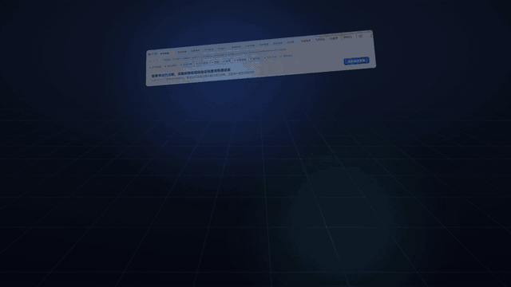
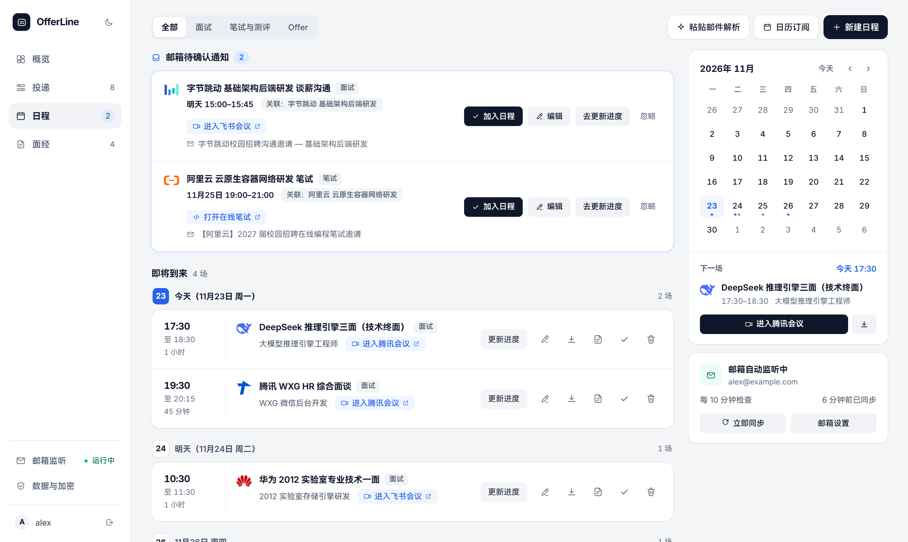
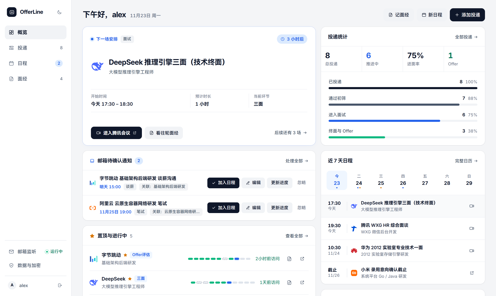
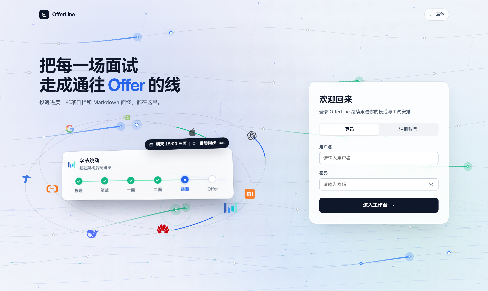

<div align="center">
  
  <h1>OfferLine</h1>
  <p><strong>Every application, interview, and debrief note on one clear timeline.</strong></p>
  <p>When you are juggling dozens of applications, spreadsheets rot fast and interview links get buried in your inbox.<br />OfferLine puts your application timeline, read-only email schedule parser, and Markdown interview notes into one self-hosted web app.</p>

  <p>
    <a href="README.md">简体中文</a>
    &nbsp;|&nbsp;
    <strong>English</strong>
  </p>

  <p>
    
    
    
    
    
  </p>

  <p>
    <a href="#1-one-timeline-for-every-application">Timeline</a>
    &nbsp;&nbsp;/&nbsp;&nbsp;
    <a href="#2-read-only-email-listener--schedule-parser-optional">Email Listener</a>
    &nbsp;&nbsp;/&nbsp;&nbsp;
    <a href="#3-overview-and-markdown-interview-notes">Overview &amp; Notes</a>
    &nbsp;&nbsp;/&nbsp;&nbsp;
    <a href="#4-privacy--security">Security</a>
    &nbsp;&nbsp;/&nbsp;&nbsp;
    <a href="#5-quick-start">Quick Start</a>
    &nbsp;&nbsp;/&nbsp;&nbsp;
    <a href="#design-docs">Design Docs</a>
  </p>
</div>

<br />

<div align="center">
  
</div>

---

## 1. One Timeline for Every Application

Open the Pipeline view and see where every single company stands without clicking through modals:


<br />

- **Multiple roles under one company**: Applied to two teams at the same company? Click `+ Add Role` to keep independent timelines stacked cleanly inside the same company card.
- **Single-click inline updates**: Every stage from Application and OA to Final Offer sits on one row. Click any dot in place to mark it passed, current, skipped, or failed.
- **Custom hiring flows per company**: Ships with Internship, Campus, and Experienced templates, and lets you add, delete, or drag-reorder stages whenever a company uses its own interview pipeline.
- **One-click portal jump with visit freshness**: Jump straight to a company's career portal and automatically refresh its last-checked badge (green within 2 days, amber at 3–5 days, orange at 6–10 days, red past 10 days) so stale portals stand out immediately.
- **Pin priorities, auto-sink closed threads**: Star top-choice companies to keep them on top; rejected or closed applications drop to the bottom automatically.
- **62 built-in company icons**: Shared company-name normalization plus 62 crisp local icons; unlisted companies fetch favicons through an SSRF-checked proxy with a clean monogram fallback.

---

## 2. Read-Only Email Listener & Schedule Parser (Optional)

Job-search inboxes are packed with OTP codes, receipts, campus livestreams, post-interview surveys, and rejection letters. Enable the optional email listener when you want schedules extracted without manual copy-paste:



<br />

### Does it mark my unread emails as read?
No. OfferLine opens your mailbox via `imapflow` in strict `readOnly: true` mode (IMAP `EXAMINE`). It never marks unread messages as seen, and never modifies or deletes mail. Presets cover QQ Mail, 163, 126, Gmail, Outlook, Tencent Exmail, and custom IMAP servers.

### Will ads, surveys, or rejections clutter my calendar?
No. Incoming mail is stripped of `<head>/<style>/<script>`, `<a href>` links hidden behind buttons are expanded, and RFC 5545 `.ics` attachments are parsed. A zero-token local rule layer then filters out noise before anything reaches your schedule:
- Drops OTPs, billing notices, recruiting livestreams, interview experience surveys, and plain application receipts;
- **Skips rejection / process-closed emails** so they never pollute your agenda;
- Semantically deduplicates repeated reminders for the same online assessment or interview.

### Does it overwrite my pipeline stages automatically?
No. Parsed interviews and assessments land in a **Pending Confirmation** queue first. OfferLine infers the matching application record read-only without mutating your timeline or creating duplicate cards; nothing enters your calendar until you review and confirm (or tweak details side-by-side against the original email).

### Three time modes & calendar subscriptions
- Handles **scheduled** interviews, **deadline** tasks (OA / offer reply), and **flexible** self-paced assessments separately.
- Generates a private `.ics` feed compatible with Android Calendar, iOS, Feishu/Lark, and Outlook (skipping flexible items and turning deadlines into all-day reminders).

### Local rules + optional personal LLM
- Local rules work out of the box with zero token cost.
- For harder edge cases, enable the standalone **LLM Enhancement** tab with your own OpenAI-compatible API key (presets for DeepSeek, Qwen, Zhipu GLM, Kimi, OpenAI, or custom endpoints, with URL normalization and live latency testing).
- **Works without IMAP too**: You can skip IMAP credentials entirely and paste raw email text directly to parse and schedule.

---

## 3. Overview and Markdown Interview Notes

### Overview Dashboard
Shows your next confirmed interview with a live countdown, one-click meeting link, and pending email items right at the top. Before an interview starts, it surfaces prior round notes for that company; afterward, it switches to writing a debrief. The right column gives clickable conversion stats and a 7-day agenda strip.



<br />

### Interview Notes & Sign-In
<table>
  <tr>
    <td width="50%">
      <strong>Markdown Interview Notes by Company &amp; Round</strong><br />
      <sub>WYSIWYG Markdown editor with a <code>/</code> slash command menu for headings, code blocks, checklists, and debrief templates (ignores mid-word slashes like <code>Java/Go</code> and URLs). Toggle <code>MD Source</code> anytime so your notes are never locked in.</sub>
      <br /><br />
      
    </td>
    <td width="50%">
      <strong>Light / Dark Themes &amp; Standalone Sign-In</strong><br />
      <sub>60fps Canvas backdrop with light and dark modes. After creating your own account on a self-hosted instance, set <code>REGISTRATION_OPEN=false</code> to lock sign-ups.</sub>
      <br /><br />
      
    </td>
  </tr>
</table>

---

## 4. Privacy & Security

- **Auth & sessions**: `crypto.scrypt` salted password hashing, `HttpOnly` + `SameSite=Lax` session cookies, same-origin CSRF enforcement, and per-route rate limiting.
- **Encrypted credentials**: IMAP app passwords and personal LLM API keys are encrypted at rest with `AES-256-GCM` and never returned in plaintext.
- **Client-side encryption**: Optional browser `WebCrypto (PBKDF2-SHA256 + AES-256-GCM)` encryption for sensitive compensation notes before upload.
- **Network isolation**: MySQL stays on a Docker `internal` network with no host port exposed; outbound icon and LLM requests block private/loopback/cloud-metadata IPs by default (set `ALLOW_LOCAL_LLM=true` to connect a local Ollama or vLLM instance).

---

## 5. Quick Start

### Option 1: Docker Compose (Recommended)

```bash
git clone https://github.com/milkfrogdev/offerline.git
cd offerline

cat > .env << EOF
APP_ORIGIN=https://your-domain.example
ALLOW_HTTP=false
REGISTRATION_OPEN=true
MYSQL_PASSWORD=$(openssl rand -hex 20)
MYSQL_ROOT_PASSWORD=$(openssl rand -hex 20)
MAIL_ENCRYPTION_KEY=$(openssl rand -hex 32)
EOF

docker compose up -d --build
```

The container listens on port `3002` behind your reverse proxy (Nginx / Caddy with HTTPS).

### Option 2: Run Locally (Node.js ≥ 22, No Database Required)

```bash
npm install
npm run build
ALLOW_HTTP=true APP_ORIGIN=http://127.0.0.1:3002 npm start
```

Without `MYSQL_HOST`, OfferLine falls back to atomic local JSON storage. Open `http://127.0.0.1:3002` and register.

---

## Design Docs

- [System Architecture & Security (docs/architecture.md)](docs/architecture.md) (Chinese)
- [Email Parsing & Schedule Sync Design (docs/mail-parsing-design.md)](docs/mail-parsing-design.md) (Chinese)

## Development & Tests

```bash
npm run check   # TypeScript checks (web + server)
npm test        # Vitest unit & Fastify integration tests
npm run build   # Build dist/web and dist/server
```

## License

[MIT](LICENSE)
