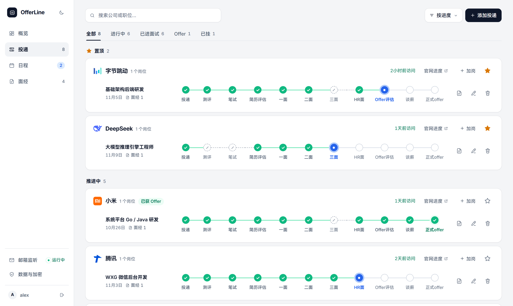

<div align="center">
  
  <h1>OfferLine</h1>
  <p><strong>Turn every application, interview schedule, and debrief note into a clear line to your Offer.</strong></p>
  <p>A self-hosted open-source workspace for personal job searches: end-to-end pipeline tracking, read-only IMAP email parsing, private ICS calendar feeds, and slash-command Markdown notes.</p>

  <p>
    <a href="README.md">简体中文</a>
    &nbsp;|&nbsp;
    <strong>English</strong>
  </p>

  <p>
    
    
    
    
    
  </p>

  <p>
    <a href="#preview">Preview</a>
    &nbsp;&nbsp;/&nbsp;&nbsp;
    <a href="#key-features">Features</a>
    &nbsp;&nbsp;/&nbsp;&nbsp;
    <a href="#email-parsing--optional-llm">Email Parsing</a>
    &nbsp;&nbsp;/&nbsp;&nbsp;
    <a href="#quick-start">Quick Start</a>
    &nbsp;&nbsp;/&nbsp;&nbsp;
    <a href="#design-docs">Design Docs</a>
  </p>
</div>

<br />

<div align="center">
  
</div>

---

## Preview

<p><strong>Overview Dashboard</strong><br /><sub>Next-interview countdown, application funnel, pending email queue, and 7-day schedule strip</sub></p>


<br />

<table>
  <tr>
    <td width="50%">
      <strong>Application Pipeline</strong><br />
      <sub>Grouped by company with 62 built-in brand logos and inline single-click stage switching</sub>
      <br /><br />
      
    </td>
    <td width="50%">
      <strong>Schedule &amp; Mini Calendar</strong><br />
      <sub>Pending email triage inbox, daily agenda timeline, and interactive hover-preview calendar</sub>
      <br /><br />
      
    </td>
  </tr>
  <tr>
    <td width="50%">
      <strong>Markdown Interview Notes &amp; <code>/</code> Slash Commands</strong><br />
      <sub>WYSIWYG Markdown editor with slash block palette, raw source toggle, and zen fullscreen</sub>
      <br /><br />
      
    </td>
    <td width="50%">
      <strong>3D Orbital Sign-In Page</strong><br />
      <sub>60fps procedural starfield canvas, 3D orbital brand showcase, light &amp; dark themes</sub>
      <br /><br />
      
    </td>
  </tr>
</table>

---

## Key Features

### 1. Application Pipeline
- **Inline horizontal stepper**: Click any stage node directly on the page to mark it passed, current, skipped, or failed without modal hops.
- **Templates & drag-and-drop**: Built-in Internship, Campus, and Experienced templates with `@dnd-kit` vertical reordering.
- **Company identity**: 62 built-in brand icons plus a shared normalization catalog (`shared/companies.ts`) and an SSRF-guarded favicon proxy (`/api/brand-icon`) for unlisted companies.
- **Progress clarity**: Pin priority companies, track career-portal visit freshness, and auto-sink closed applications.

### 2. Overview Command Deck
- **Pre-interview spotlight**: Live countdown to your next confirmed session with direct meeting/exam links; switches contextually between reviewing prior rounds for that company before the interview and writing a debrief afterward.
- **Conversion funnel & 7-day rhythm**: Clickable funnel stats and a 7-day schedule strip with multi-line hover previews.

### 3. Minimalist Interview Notes
- **Unified WYSIWYG Markdown**: Use the monochrome toolbar or live Markdown shortcuts (`# `, `**`, `- `, `[ ] `, `> `) backed by plain Markdown storage, with an instant `MD Source` toggle.
- **`/` Slash command palette**: Type `/` at the start of a line or after whitespace to insert headings, lists, checklists, code blocks, quotes, dividers, or an interview Q&A debrief block (supports English, Chinese, and Pinyin search; ignores mid-word slashes like `Java/Go` or URLs).
- **Zen fullscreen**: Portal fullscreen canvas where `Esc` dismisses the slash menu before collapsing fullscreen.

---

## Email Parsing & Optional LLM

OfferLine ships with a hardened, zero-token rule engine plus an optional bring-your-own OpenAI-compatible LLM enhancer:

| Stage | Design |
|---|---|
| **Strict read-only IMAP** | Opens mailboxes with `readOnly: true` (IMAP `EXAMINE`), never marking unread emails as seen; presets for QQ, 163, 126, Gmail, Outlook, Tencent Exmail, and custom IMAP |
| **HTML & ICS extraction** | Strips `<head>/<style>/<script>` to prevent CSS truncation, expands `<a href>` links so hidden meeting/exam buttons survive, and parses RFC 5545 `.ics` invites |
| **6-gate noise filter** | Blocks OTPs/invoices, freelance platforms, post-interview experience surveys, campus livestreams/promos, **rejections** (kept out of schedules), and pure application receipts at 0 tokens |
| **3-mode times & dedup** | Separates `scheduled`, `deadline`, and `flexible` events; semantically merges duplicate exam reminders; exports timed events and all-day `[Deadline]` reminders to `.ics` while skipping `flexible` tasks |
| **Non-destructive record linking** | Never auto-mutates your pipeline timeline or silently spawns duplicate records; infers the linked record read-only (`company + position -> sole active in company -> sole active in corporate group`) with a 1-click edit modal |
| **Standalone personal LLM** | Dedicated tab decoupled from IMAP (usable for paste-to-parse alone), 6 provider presets (DeepSeek, Qwen DashScope, Zhipu GLM, Kimi, OpenAI, custom), smart endpoint normalization, live latency probe, `response_format` 400 fallback, and DNS/private-IP SSRF blocking |

---

## Privacy & Security

- **Auth & sessions**: `crypto.scrypt` salted password hashes, `HttpOnly` + `SameSite=Lax` cookies, same-origin CSRF checks, and per-route rate limiting.
- **Encrypted secrets**: IMAP app passwords and personal LLM keys are encrypted at rest with `AES-256-GCM` and never returned in plaintext.
- **Client-side vault**: Optional browser `WebCrypto` (`PBKDF2-SHA256` + `AES-256-GCM`) encryption for sensitive compensation notes.
- **Network isolation**: MySQL stays on an `internal` Docker network with no host port exposure; outbound icon and LLM requests block loopback, RFC1918, and cloud metadata IPs by default (set `ALLOW_LOCAL_LLM=true` to connect local Ollama/vLLM).

---

## Quick Start

### Option 1: Docker Compose (Recommended)

```bash
git clone https://github.com/milkfrogdev/offerline.git
cd offerline

cat > .env << EOF
APP_ORIGIN=https://your-domain.example
ALLOW_HTTP=false
REGISTRATION_OPEN=true
MYSQL_PASSWORD=$(openssl rand -hex 20)
MYSQL_ROOT_PASSWORD=$(openssl rand -hex 20)
MAIL_ENCRYPTION_KEY=$(openssl rand -hex 32)
EOF

docker compose up -d --build
```

The app listens on container port `3002` behind your reverse proxy (Nginx / Caddy with HTTPS).

### Option 2: Local Node.js (Node ≥ 22, zero-DB fallback)

```bash
npm install
npm run build
ALLOW_HTTP=true APP_ORIGIN=http://127.0.0.1:3002 npm start
```

Without `MYSQL_HOST`, OfferLine automatically uses atomic local JSON file storage. Open `http://127.0.0.1:3002` to register.

---

## Design Docs

- [System Architecture & Security (docs/architecture.md)](docs/architecture.md) (Chinese)
- [Email Parsing & Sync Pipeline Design (docs/mail-parsing-design.md)](docs/mail-parsing-design.md) (Chinese)

## Development & Tests

```bash
npm run check   # TypeScript type checks (web + server)
npm test        # Vitest unit & Fastify integration tests
npm run build   # Build dist/web and dist/server
```

## License

[MIT](LICENSE)
