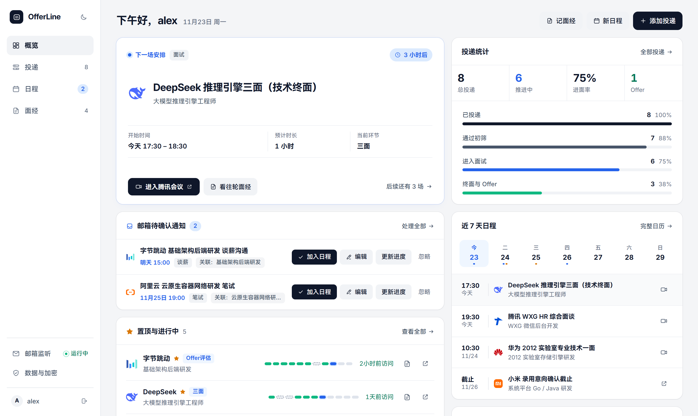
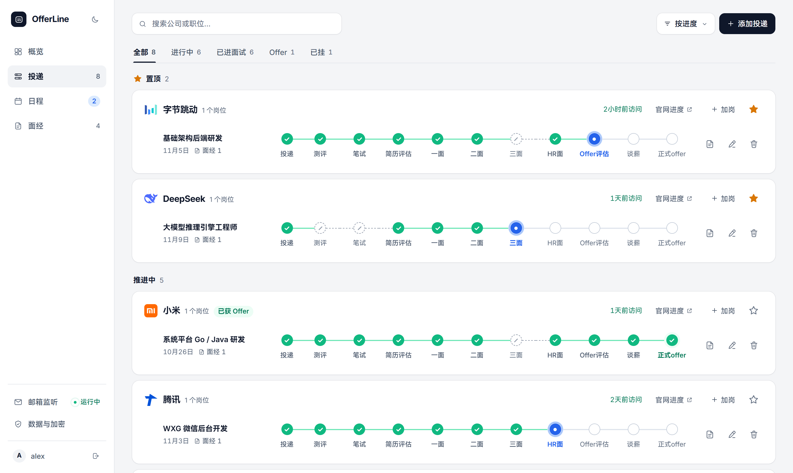
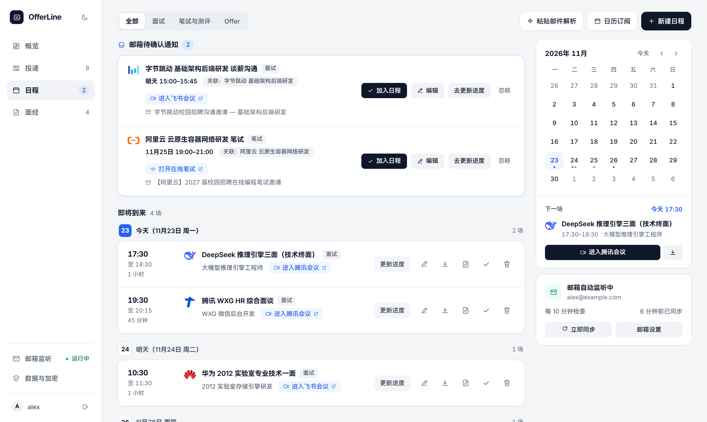
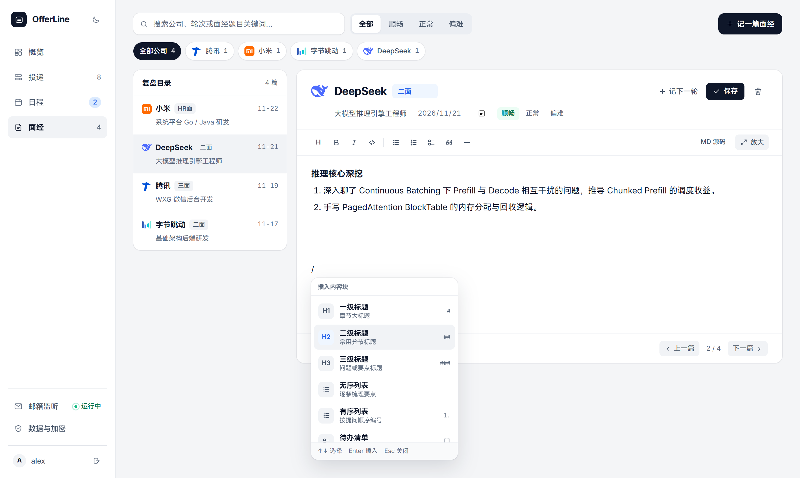

<div align="center">
  
  <h1>OfferLine</h1>
  <p><strong>把每一场投递、面试日程与复盘面经，走成通往 Offer 的线。</strong></p>
  <p>面向个人求职周期的开源自托管工作台：全链路进度追踪、只读邮箱自动解析日程、私有 ICS 日历订阅与斜杠命令面经知识库。</p>

  <p>
    
    
    
    
    
  </p>

  <p>
    <a href="#界面预览">界面预览</a>
    &nbsp;&nbsp;/&nbsp;&nbsp;
    <a href="#核心能力">核心能力</a>
    &nbsp;&nbsp;/&nbsp;&nbsp;
    <a href="#邮箱解析与大模型增强">邮箱解析</a>
    &nbsp;&nbsp;/&nbsp;&nbsp;
    <a href="#快速部署">快速部署</a>
    &nbsp;&nbsp;/&nbsp;&nbsp;
    <a href="#设计文档">设计文档</a>
  </p>
</div>

<br />

<div align="center">
  
</div>

---

## 界面预览

<table>
  <tr>
    <td width="50%">
      <strong>全链路投递时间线</strong><br />
      <sub>按公司聚合岗位，62 家海内外科技企业官方图标，横向节点就地点击切换进度</sub>
      <br /><br />
      
    </td>
    <td width="50%">
      <strong>日程工作台与迷你月历</strong><br />
      <sub>左栏待确认邮箱通知与按日议程，右栏交互迷你月历与悬停场次预览</sub>
      <br /><br />
      
    </td>
  </tr>
  <tr>
    <td width="50%">
      <strong>极简面经知识库与 <code>/</code> 斜杠命令</strong><br />
      <sub>所见即所得 Markdown，输入 <code>/</code> 呼出中英/拼音块菜单，支持全屏专注模式</sub>
      <br /><br />
      
    </td>
    <td width="50%">
      <strong>3D 星轨登录门面</strong><br />
      <sub>60fps Canvas 动态星网与无框大厂星轨陀螺仪，支持浅色 / 深色双主题</sub>
      <br /><br />
      
    </td>
  </tr>
</table>

---

## 核心能力

### 1. 全链路投递追踪（`投递`）
- **横向时间线直点**：单页平铺每个岗位的完整阶段节点，就地点击切换状态（通过 / 当前 / 跳过 / 未通过 / 拒绝），告别反复弹窗。
- **灵活流程与拖拽编排**：内置实习、校招、社招三套常用模板，支持自由增删与拖拽重排阶段。
- **官方品牌图标体系**：内置 62 家海内外科技企业官方矢量图标与公司/集团名称归一化词典，其余公司支持经 SSRF 安全代理自动拉取官网图标或生成单字标。
- **节奏感知**：支持公司置顶、官网访问新鲜度打卡与已终止流程自动沉底。

### 2. 概览工作台（`概览`）
- **考前聚焦**：首页「下一场安排」实时倒计时，一键进入腾讯会议 / 飞书 / Zoom / 牛客 / 赛码；开面前自动切换为「看往轮面经」或「编辑安排」，开面后切为「面后写复盘」。
- **投递统计与 7 日节奏**：总投递、推进中、进面率、Offer 转化条点击直达对应筛选，7 天节奏带悬停直看当日所有面试与笔试。

### 3. 极简面经知识库（`面经`）
- **所见即所得 Markdown**：支持鼠标点选单色工具栏，也支持 `# `、`**`、`- `、`[ ] `、`> ` 即时渲染，底层统一存标准 Markdown 文本并可随时切 `MD 源码` 粘贴整篇原文。
- **飞书 / 语雀风 `/` 斜杠命令**：行首或空格后敲 `/` 唤起命令菜单，支持中文、英文与拼音首字母筛选（如 `/dm` 代码块、`/db` 待办、`/tm` 面试题复盘模板），词中斜杠（如 `Java/Go`、`https://`）不误触发。
- **全屏沉浸写作**：支持一键 Portal 全屏放大，`Esc` 优先关闭斜杠菜单再收起全屏，不误关外层弹窗。

---

## 邮箱解析与大模型增强

求职季收件箱混杂了大量验证码、账单、宣讲直播、面试调研问卷和拒信。OfferLine 的邮件管线针对真实中文与英文招聘邮箱做了专门加固：

| 环节 | 实现方式 |
|---|---|
| **严格只读拉取** | `imapflow` 统一以 `readOnly: true`（IMAP `EXAMINE`）打开收件箱，**绝不改动邮件未读状态**，支持 QQ、163、126、Gmail、Outlook、腾讯企业邮与自定义 IMAP |
| **正文与附件清洗** | 剥离 `<head>/<style>/<script>` 防止 CSS 截断正文，展开 `<a href>` 保留隐藏会议/笔试链接，同步解析 RFC 5545 `.ics` 日历附件 |
| **6 重前置门控** | 零 Token 规则层直接拦截验证码/账单、专家平台、面试体验/满意度调研、校招直播与热招宣传、**拒信/流程终止**（不污染日程）以及纯投递回执 |
| **三态时间与去重** | 区分 `固定时刻 (scheduled)` / `截止日期 (deadline)` / `时间自定 (flexible)`；同一场考试连发多封提醒自动语义去重合并字段；`.ics` 订阅跳过时间自定项、截止项转为全天提醒 |
| **非破坏性单活关联** | **绝不自动篡改投递时间线或静默建新记录**，按「同公司+岗位 → 同公司唯一进行中流程 → 同集团唯一进行中流程」只读推断关联岗位，附带一键直达更新与三合一编辑兜底弹窗 |
| **可选个人大模型** | 独立「大模型增强」页签（不连 IMAP 也能单独保存给粘贴解析使用），内置 DeepSeek、通义千问、智谱 GLM、Kimi、OpenAI、自定义兼容 6 项预设，支持智能 URL 归一化、实时连通测速、`response_format` 降级与 DNS/私网 SSRF 防护 |

---

## 隐私与安全设计

- **账号与会话**：`crypto.scrypt` 加随机盐哈希密码，`HttpOnly` + `SameSite=Lax` Cookie 会话，写请求强制同源 `Origin` 校验与限流。
- **服务端凭据加密**：IMAP 授权码与个人大模型 API Key 经 `AES-256-GCM` 密文落库，接口永不回传明文。
- **浏览器端零知识保险箱**：单条投递支持在浏览器侧以 `WebCrypto PBKDF2-SHA256 + AES-256-GCM` 加密敏感薪资/备注后仅上传密文。
- **网络与出站隔离**：Docker 部署下 MySQL 锁在 `internal` 内网不暴露宿主机端口；官网图标代理与大模型出站均做 DNS + IPv4/IPv6 私网及云元数据拦截（自托管连本地 Ollama 可通过 `ALLOW_LOCAL_LLM=true` 显式放行）。

---

## 快速部署

### 方式一：Docker Compose 自托管（推荐）

```bash
git clone https://github.com/milkfrogdev/offerline.git
cd offerline

cat > .env << EOF
APP_ORIGIN=https://your-domain.example
ALLOW_HTTP=false
REGISTRATION_OPEN=true
MYSQL_PASSWORD=$(openssl rand -hex 20)
MYSQL_ROOT_PASSWORD=$(openssl rand -hex 20)
MAIL_ENCRYPTION_KEY=$(openssl rand -hex 32)
EOF

docker compose up -d --build
```

应用监听容器内 `3002` 端口，前置 Nginx / Caddy 反代并开启 HTTPS 即可。

### 方式二：本地开发与体验（Node.js ≥ 22，零数据库启动）

```bash
npm install
npm run build
ALLOW_HTTP=true APP_ORIGIN=http://127.0.0.1:3002 npm start
```

未配置 `MYSQL_HOST` 时自动回落到本地原子落盘 JSON 存储，打开 `http://127.0.0.1:3002` 注册即可使用。

### 环境变量一览

| 变量名 | 默认值 | 说明 |
|---|---|---|
| `APP_PORT` | `3002` | 服务监听端口 |
| `APP_ORIGIN` | `http://127.0.0.1:3002` | 对外访问 Origin，用于 CSRF 校验与日历订阅链接 |
| `ALLOW_HTTP` | `false` | 本地或纯内网 HTTP 访问时设为 `true` |
| `REGISTRATION_OPEN` | `true` | 个人自用完成注册后可改为 `false` 关闭新用户注册 |
| `MAIL_ENCRYPTION_KEY` | — | 服务端加密邮箱授权码与模型 Key 的 32 字节随机密钥 |
| `ALLOW_LOCAL_LLM` | `false` | 如需连接本机/内网 Ollama 或 vLLM，显式设为 `true` |
| `MYSQL_HOST` / `MYSQL_DATABASE` / `MYSQL_USER` / `MYSQL_PASSWORD` | — | MySQL 8.4 连接参数（留空则走本地 JSON 文件存储） |

---

## 技术栈与设计文档

- **前端**：React 19 / TypeScript / Vite / Tiptap v3 / `@dnd-kit`（离线内置 `Inter` + `HarmonyOS Sans SC`）
- **后端**：Node.js 24 / Fastify 5 / Zod / MySQL 8.4（`mysql2` 纯 JS 驱动）/ `imapflow` / `mailparser`

更详细的工程设计可查阅仓库内文档：

- [系统架构与安全设计（docs/architecture.md）](docs/architecture.md) — 整体分层、MySQL 8.4 8 表模型与零停机增量迁移、SSRF 与网络隔离边界。
- [求职邮件解析与日程同步设计（docs/mail-parsing-design.md）](docs/mail-parsing-design.md) — 7 阶段解析管道、12 类真实异常 Case 对策、去自动改时间线取舍、三态时间模型与个人大模型适配。

## 开发与测试

```bash
npm run check   # TypeScript 前后端类型检查
npm test        # Vitest 单元测试与 Fastify 集成测试
npm run build   # 构建 dist/web 与 dist/server
```

## License

[MIT](LICENSE)
